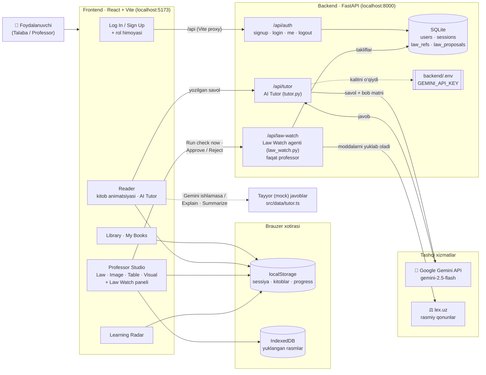

# SmartBook

Huquqiy ta’lim uchun raqamli kutubxona va darslik yaratish platformasi (LexHackathon, TDYU).
Frontend — React (Vite). Backend — kichik FastAPI server (SQLite): foydalanuvchilar, Gemini asosidagi AI Tutor va lex.uz’ni tekshiruvchi Law Watch agenti.

## Arxitektura



**AI qanday ishlaydi:**

1. **AI Tutor (Gemini).** Talaba Reader’dagi AI Tutor oynasiga savol yozadi → frontend uni bob matni bilan birga `/api/tutor` ga yuboradi → backend `backend/.env` dagi kalit bilan Gemini’ga so‘rov yuboradi va javobni qaytaradi. API kalit faqat serverda turadi, brauzerga chiqmaydi.
2. **Zaxira (fallback).** Kalit bo‘lmasa, noto‘g‘ri bo‘lsa, internet yo‘q bo‘lsa yoki Gemini 20 soniyada javob bermasa — talabaga xatosiz tayyor (mock) javob ko‘rsatiladi. “Explain / Summarize / Ask AI” va tayyor savollar doim tayyor javoblardan foydalanadi.
3. **Law Watch agenti.** Professor “Run check now” bosadi → agent lex.uz’dan qonunni yuklab oladi, kitobdagi iqtiboslarni tekshiradi va SQLite’ga taklif yozadi → kitob faqat professor **Approve** bosgandan keyin o‘zgaradi. Bu agent AI modeldan foydalanmaydi — qarorlar qoidalar asosida, tekshirib bo‘ladigan tarzda qabul qilinadi.

## Talablar

- **Node.js 18 yoki undan yangi versiya** (https://nodejs.org)
- **Python 3.10 yoki undan yangi versiya** (https://www.python.org)

Versiyalarni tekshirish:

```bash
node -v
python3 --version
```

## 1. Backendni ishga tushirish (foydalanuvchilar)

Birinchi terminalda:

```bash
cd backend
python3 -m venv .venv
source .venv/bin/activate        # Windows: .venv\Scripts\activate
pip install -r requirements.txt
uvicorn main:app --reload --port 8000
```

Foydalanuvchilar `backend/data/smartbook.db` faylida saqlanadi. Bu fayl birinchi ishga tushirishda o‘zi yaratiladi.
API hujjatlari: **http://localhost:8000/docs**

Keyingi safar faqat `source .venv/bin/activate` va `uvicorn main:app --reload --port 8000` buyruqlari yetarli.

## 2. Frontendni ishga tushirish

Ikkinchi terminalda (loyiha papkasida):

```bash
npm install
npm run dev
```

So‘ng brauzerda **http://localhost:5173** manzilini oching.

> Backend ishlamasa, kirish sahifasida “Cannot reach the SmartBook server” xabari chiqadi.

## Tizimga kirish

Demo hisoblardan birini ishlating yoki “Sign Up” sahifasida o‘z hisobingizni yarating.

| Rol | Email | Parol |
| --- | --- | --- |
| Talaba | `student@smartbook.demo` | `student-demo` |
| Professor | `professor@smartbook.demo` | `professor-demo` |

Rolni almashtirish uchun yuqori o‘ng burchakdagi hisob menyusidan chiqing (Log out) va boshqa hisob bilan kiring.

## AI Tutor uchun Gemini (ixtiyoriy)

AI Tutor oynasida yozilgan savollarga **Gemini** javob beradi. Kalit bo‘lmasa yoki Gemini ishlamasa, avvalgidek tayyor (mock) javoblar ko‘rsatiladi — ilova to‘xtamaydi.
Belgilangan matn uchun “Explain / Summarize / Ask AI” va tayyor savollar har doim tayyor javoblardan foydalanadi.

1. https://aistudio.google.com/apikey sahifasida bepul API kalit oling.
2. `backend/.env.example` faylidan nusxa olib, `backend/.env` yarating va kalitni qo‘ying:
   ```
   GEMINI_API_KEY=sizning_kalitingiz
   ```
3. Backendni qayta ishga tushiring.

`.env` fayli GitHub’ga yuklanmaydi. Kalitni hech kimga yubormang.

## Law Watch agenti (Lex.uz tekshiruvi)

Kichik agent kitoblarda keltirilgan qonun moddalarini **haqiqiy lex.uz** sahifasi bilan solishtiradi:

1. Fuqarolik kodeksini lex.uz’dan yuklab oladi va moddalarga ajratadi.
2. Har bir iqtibos uchun tekshiradi: modda raqami mavzuga mosmi, modda kuchini yo‘qotganmi, matni o‘zgarganmi.
3. Muammo topsa, professorga taklif yuboradi. Kitob **faqat professor tasdiqlagandan keyin** o‘zgaradi.

Sinab ko‘rish: professor sifatida kiring → **Studio** → o‘ngdagi **Law Watch** paneli → **Run check now**.
Agent “Civil Law Fundamentals” kitobida taklif (oferta) uchun 365-modda ko‘rsatilganini, lex.uz’da esa oferta hozir **367-modda** ekanini topadi.
**Approve & update book** bosilgach, talaba o‘quvchida tuzatilgan moddani va rasmiy matnni ko‘radi.

Kod: `backend/law_watch.py` (agent), `backend/main.py` (`/api/law-watch` endpointlari, faqat professorlar uchun).

## Production uchun yig‘ish (ixtiyoriy)

```bash
npm run build
npm run preview
```

So‘ng **http://localhost:4173** manzilini oching (backend ham ishlab turishi kerak).

## Eslatmalar

- Hisoblar backendda (SQLite) saqlanadi, parollar faqat xesh ko‘rinishida. O‘qish jarayoni va kitoblar esa brauzerda saqlanadi.
- Boshidan boshlash uchun istalgan sahifa pastidagi **Reset demo data** tugmasini bosing.
- AI Tutor Gemini orqali ishlaydi (kalit bo‘lmasa — tayyor javoblar). Law Watch haqiqiy lex.uz sahifasini tekshiradi. Kitoblar va shaxslar to‘qima demo kontentdir.
